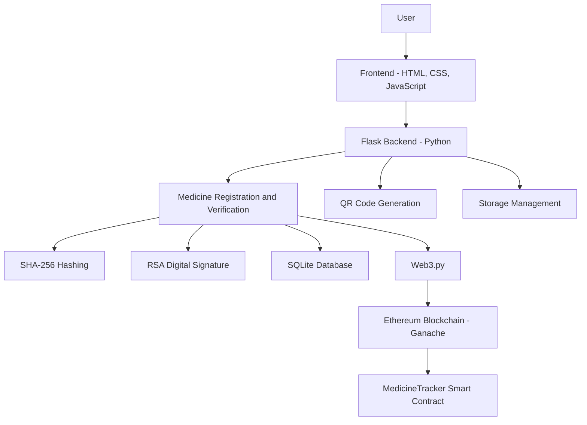

# MediTrace 💊
### Blockchain-Based Medicine Authenticity and Storage Tracker

MediTrace is a blockchain-based application designed to improve medicine authenticity verification, data security, and storage tracking using cryptographic techniques and Ethereum smart contracts.

## 🚀 Key Features

- Medicine registration and management
- SHA-256 hashing for data integrity
- RSA digital signatures for authenticity verification
- Ethereum blockchain integration
- Smart contract-based medicine verification
- QR code generation for medicine identification
- Medicine inventory and expiry tracking
- Interactive dashboard

## 🏗️ System Architecture



## 🔄 How It Works

1. **Registration:** Users enter medicine details into the application.
2. **Hash Generation:** The system generates a SHA-256 hash of the medicine record.
3. **Digital Signature:** RSA creates a digital signature to support authenticity verification.
4. **Blockchain Storage:** The medicine ID and hash are registered through an Ethereum smart contract.
5. **Verification:** The system checks the record hash, RSA signature, and blockchain data.
6. **Storage Tracking:** The dashboard monitors stock quantity and expiry information.
7. **QR Code:** A QR code is generated for medicine identification.

## 🛠️ Technology Stack

| Category | Technology |
|---|---|
| Frontend | HTML, CSS, JavaScript |
| Backend | Python, Flask |
| Database | SQLite |
| Hashing | SHA-256 |
| Digital Signature | RSA |
| Blockchain | Ethereum |
| Smart Contract | Solidity |
| Blockchain Integration | Web3.py |
| Local Blockchain | Ganache |
| QR Generation | Python QR Code Library |

## 📂 Project Structure

```text
MediTrace/
│
├── backend/
│   ├── app.py
│   ├── blockchain.py
│   ├── blockchain_utils.py
│   ├── crypto_utils.py
│   ├── database.py
│   ├── deploy_contract.py
│   ├── storage.py
│   └── requirements.txt
│
├── contracts/
│   └── MedicineTracker.sol
│
├── blockchain/
│   └── MedicineRegistry.sol
│
├── frontend/
│   ├── index.html
│   ├── register.html
│   ├── verify.html
│   ├── storage.html
│   ├── blockchain.html
│   ├── style.css
│   └── JavaScript files
│
├── .gitignore
└── README.md
```

## ⚙️ Installation and Setup

**1. Clone the repository**

```bash
git clone https://github.com/vinodh2007/MediTrace.git
cd MediTrace
```

**2. Create a virtual environment**

```bash
python -m venv venv
```

**3. Activate the environment (Windows PowerShell)**

```powershell
.\venv\Scripts\Activate.ps1
```

**4. Install dependencies**

```bash
pip install -r backend/requirements.txt
```

**5. Start Ganache**

Run your local Ethereum blockchain and ensure its RPC endpoint and chain ID match the backend configuration.

**6. Deploy the smart contract**

```bash
python backend/deploy_contract.py
```

**7. Start the Flask backend**

```bash
python backend/app.py
```

Open the frontend using your configured local web server.

## 🔐 Security

- SHA-256 hashing helps detect unauthorized modifications.
- RSA digital signatures support medicine record authenticity checks.
- Blockchain records provide a tamper-resistant verification reference.
- SQLite stores medicine and inventory information.

## 🎯 Project Objectives

- Improve medicine record transparency.
- Detect unauthorized modifications to medicine data.
- Explore blockchain technology in pharmaceutical traceability.
- Demonstrate cryptography and smart contract integration.

## 🔮 Future Enhancements

- Mobile-friendly QR verification.
- Manufacturer and distributor authentication.
- Advanced inventory alerts.
- Public blockchain deployment.
- Detailed audit reports.

## 👨‍💻 Author

**Vinodh Reddy**

B.Tech – Information Science and Technology

GitHub: [vinodh2007](https://github.com/vinodh2007)

## 📌 Disclaimer

MediTrace is an academic prototype developed for educational purposes. It is not a certified pharmaceutical authentication system.
